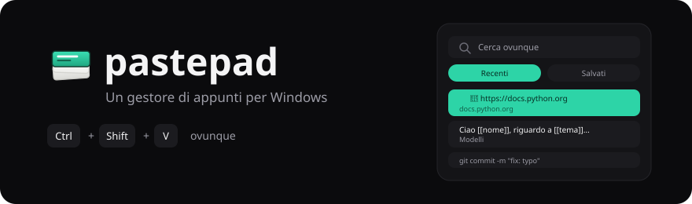

<div align="center">



<hr>

**Un gestore di appunti per Windows, in italiano.**

</div>

Windows conserva 25 voci degli appunti e le dimentica al riavvio.
pastepad ne conserva 80, più tutto ciò che archivi nelle tue cartelle,
che non scade mai.

Premi <kbd>Ctrl</kbd>+<kbd>Shift</kbd>+<kbd>V</kbd> ovunque. Scrivi due
lettere, premi <kbd>Invio</kbd>, e il testo finisce nel campo in cui
stavi lavorando.

Questa è una copia in italiano di
[pastepad di Josemgu](https://github.com/Josemgu/pastepad): interfaccia,
codice e documentazione sono stati tradotti. Nomi dei file di dati e
chiavi dei JSON sono cambiati, quindi i dati non sono compatibili con
quelli della versione originale.

## Cosa fa

Tutto ciò che copi compare in Recenti, testo e schermate allo stesso
modo. Fissa ciò che usi spesso e resta in alto.

I testi salvati vivono in cartelle a cui dai tu il nome, e uno con dei
`[[campi]]` dentro diventa un modello — pastepad li chiede prima di
incollare.

Ogni testo salvato è una di cinque cose — segnalibro, modello, email,
prompt IA o nota — e Salvati tiene ognuna nel suo gruppo richiudibile.
pastepad propone quella adatta a ciò che hai scritto e tu la cambi se ha
sbagliato.

Email e prompt IA sono i due che non indovina mai, ed è proprio per
questo che puoi sceglierli: tutti e due sono testo normale senza niente
dentro che dica cosa sono. Cinque corpi di email che iniziano tutti con
"Ciao a tutti," erano cinque note in più, e una raccolta di prompt
spariva in mezzo a loro.

Copia un indirizzo web da solo e la riga mostra il dominio e una voce
Apri nel browser nel suo menu. Il clic continua a incollare, come tutto
il resto della cronologia.

**Un segnalibro che hai salvato invece si apre.** Salvare un indirizzo
come segnalibro significa che vuoi visitarlo, quindi il clic fa quello;
copiarlo e incollarlo stanno nel menu dei tre punti. Se preferisci che
incolli, cambia il suo tipo in Nota.

La scheda Note è un blocco a parte: ciò che scrivi lì resta lì e non si
incolla. Si apre come una lavagna dentro il pannello e si salva a ogni
tasto.

La ricerca copre Recenti e Salvati. Le parole possono arrivare in
qualsiasi ordine e gli accenti si ignorano.

I gestori di password marcano il loro contenuto come privato, e pastepad
non lo registra mai. KeePass, Bitwarden, Gestione credenziali di Windows
e le finestre in incognito di Chrome lo fanno tutti.

## Modelli

Tutto ciò che metti tra `[[doppie parentesi quadre]]` diventa uno spazio
da riempire. La riga è marcata perché si capisca a colpo d'occhio quali
chiederanno, e i modelli stanno in un loro gruppo sotto Salvati.

**Crearne uno**

1. Apri il pannello, vai su **Salvati**, premi **Nuovo**.
2. Scrivi il testo, e metti le `[[parentesi]]` intorno a ciò che cambia
   ogni volta.
3. Scegli una cartella sotto **Salva in** e premi **Salva**.

**Usarlo**

Clicca nel campo che vuoi riempire, apri il pannello, e clicca il
modello. Compare **Completa prima di incollare** con una casella per
ogni spazio. Riempile e premi **Incolla**.

Per i dati che riscrivi di continuo:

```
Nome: [[nome]]
Cognome: [[cognome]]
Data di nascita: [[data di nascita]]
```

Per un'email:

```
Ciao [[nome]], ti riscrivo a proposito di [[argomento]] del [[data]].
```

**Email: una cartella per gli oggetti, una per i corpi**

In Gmail e Outlook l'oggetto e il corpo sono due campi separati, e
pastepad incolla in un campo alla volta — quello in cui stava il
cursore. Invece di combattere, dai a ognuno la sua cartella:

1. Crea una cartella chiamata **Oggetti** e un'altra chiamata **Corpi**.
2. Clicca nel campo dell'oggetto, apri il pannello, scegli da
   **Oggetti**.
3. Clicca nel corpo, riapri il pannello, scegli da **Corpi**.

Due incolla, e scegli ogni volta il corpo che vuoi invece di essere
legato a uno. Le cartelle possono mostrarsi come etichette in alto, così
ogni lista è a un clic.

## Come si usa

| Tasto | Azione |
|:--|:--|
| <kbd>Ctrl</kbd> <kbd>Shift</kbd> <kbd>V</kbd> | Apre il pannello vicino al cursore |
| Scrivere | Filtra mentre scrivi |
| <kbd>↑</kbd> <kbd>↓</kbd> | Si muove tra i risultati |
| <kbd>Invio</kbd> | Incolla |
| <kbd>Esc</kbd> | Chiude |

Clicca nel campo che vuoi riempire prima di aprire il pannello. pastepad
ricorda quale finestra aveva il focus e glielo restituisce prima di
incollare.

La X nasconde soltanto il pannello. Per chiuderlo davvero, usa Esci
dall'icona nell'area di notifica.

## Installazione

Serve il [.NET 10 SDK](https://dotnet.microsoft.com/download). Dalla
radice del repo:

```powershell
.\pubblica.ps1
```

Chiede se pubblicare in modo normale, anche come zip (da portare su un
altro computer), o caricando lo zip come release su GitHub; poi compila
in Release e lascia il programma pronto nella cartella
`pubblicato-x64`, dentro il repo. Si avvia da `pastepad.exe` in quella
cartella; l'eseguibile da solo non basta, serve l'intera cartella. Per
metterlo altrove: `.\pubblica.ps1 -Destinazione "D:\programmi\pastepad"`.

```
programma   pubblicato-x64 (o la destinazione scelta)
dati        %LOCALAPPDATA%\pastepad
```

Non chiede l'amministratore. Programma e dati stanno in cartelle
separate apposta: togliere il programma lascia stare i tuoi dati.

Al primo avvio pastepad si registra per partire con Windows da quella
cartella: se la sposti, aprilo una volta dal posto nuovo.

Chi preferisce un installer in un solo file può costruirlo con
[Inno Setup](https://jrsoftware.org/isinfo.php) a partire da
`installer/pastepad.iss`.

## L'avviso di Windows

Un eseguibile non firmato fa comparire *"PC protetto da Windows"* la
prima volta. Scegli **Ulteriori informazioni**, poi **Esegui comunque**.

SmartScreen non legge la licenza né il sorgente. Cerca una firma e una
storia di download, e un programma nuovo non firmato non ha né l'una né
l'altra.

## Com'è fatto

C# su .NET 10 con WinUI 3. Gli appunti, la scorciatoia globale, l'icona
nell'area di notifica e il passaggio del focus sono chiamate Win32; il
resto è XAML. Lo strato dei dati ha 118 prove che girano senza aprire
una finestra.

Le versioni fino alla 3.0.1 erano scritte in Python con Flet. Fu
abbandonato perché la scorciatoia globale smetteva di rispondere dopo
poche pressioni. Il codice vecchio vive nel tag `ultima-version-python`,
e [PIANO.md](PIANO.md) e [PASSAGGIO.md](PASSAGGIO.md) raccontano il
ragionamento.

## I tuoi dati

In `%LOCALAPPDATA%\pastepad`, come file semplici che puoi copiare o
mettere in backup:

```
snippets.json     testi salvati e cartelle
cronologia.json   cronologia automatica
note.json         le note del blocco
config.json       tema, colore, scorciatoia, dimensione
immagini\         schermate copiate
```

La cronologia non è cifrata. Il contenuto dei gestori di password si
scarta da solo, ma tutto il resto che copi viene scritto. La scopa nel
piede svuota la cronologia e il pulsante di pausa ferma la cattura. Vedi
[SECURITY.md](SECURITY.md).

Non tenere la cartella dentro OneDrive. La sincronizzazione può bloccare
i file mentre pastepad li scrive.

## Personalizzarlo

Dodici sfondi e diciotto colori di accento. "Come Windows" cambia il
tema dal vivo quando lo fa il sistema. Ogni accento è stato verificato
per il contrasto con il testo che ci si disegna sopra.

Il pannello si ridimensiona trascinandone i bordi e ricorda dove l'hai
lasciato.

## Design

L'interfaccia fu disegnata prima di essere costruita: 35 maquette SVG in
[docs/mockups](docs/mockups), con la tavolozza, le misure e il
comportamento in [SPECIFICHE-UI.md](docs/SPECIFICHE-UI.md).

## Perché un altro

[Ditto](https://github.com/sabrogden/Ditto) e
[CopyQ](https://github.com/hluk/CopyQ) sono buoni programmi con anni di
lavoro alle spalle. Questo esiste perché all'autore servivano due cose
che nessuno dei due fa così com'è: modelli da riempire per le note che
si riscrivono di continuo, e incolla con formato che sopravvive fino a
Outlook.

---

<div align="center">
<sub>progetto originale di <a href="https://github.com/Josemgu">Josemgu</a></sub>
</div>
